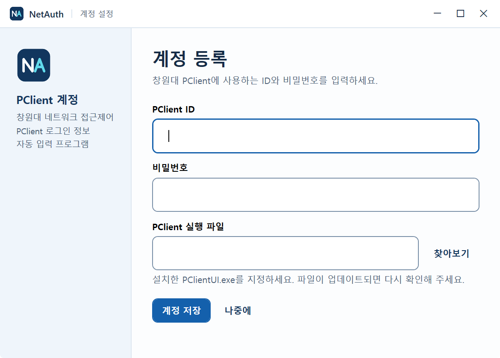

  
  <h1>NetAuth</h1>
  
<strong>창원대학교 PClient 로그인 자동화</strong>

  
저장한 계정으로 캠퍼스 네트워크에 연결하는 과정을 줄이는 Windows 앱입니다.

  
<a href="#미리보기">화면 미리보기</a> · <a href="#지원-범위">지원 범위</a> · <a href="#license">License</a>

## 미리보기

  

## 지원 범위

**계정 자동 입력** · PClient가 로그아웃 상태일 때 저장한 ID와 비밀번호를 로그인 화면에 채웁니다. 계정 정보는 현재 Windows 사용자 범위에서 암호화해 보관합니다.

**Windows 시작 시 자동 로그인** · PC를 켜고 Windows에 로그인하면 시작 프로그램으로 실행되어 PClient 인증까지 진행하는 기능을 개발하고 있습니다. 실제 PClient에서 검증한 뒤 제공할 예정입니다.

**Windows x64** · 공개 설치본은 준비 중입니다.

## License

NetAuth is licensed under the [MIT License](LICENSE).
